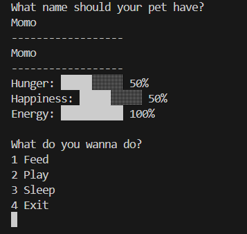
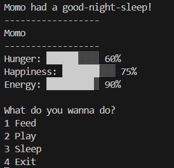
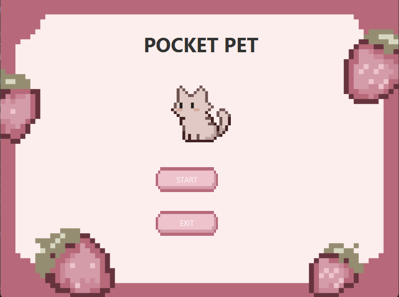
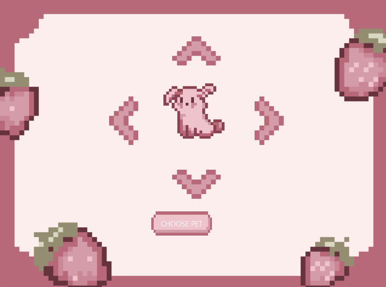
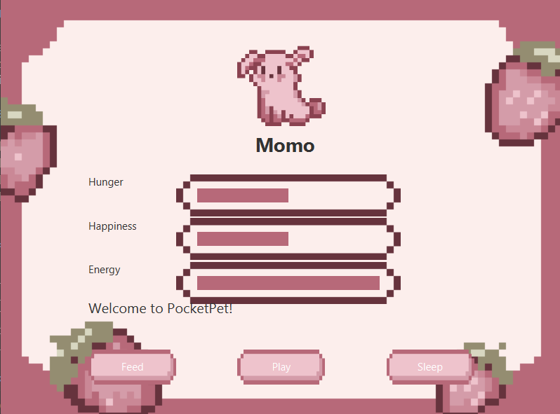
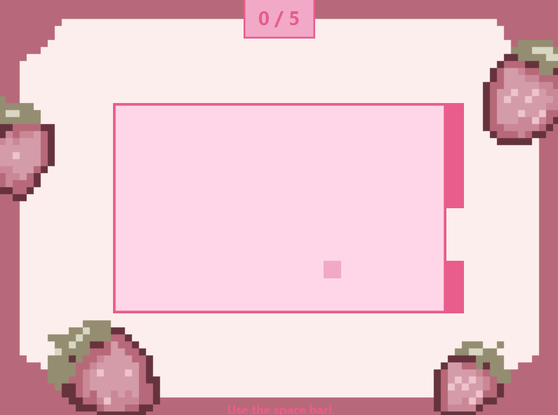
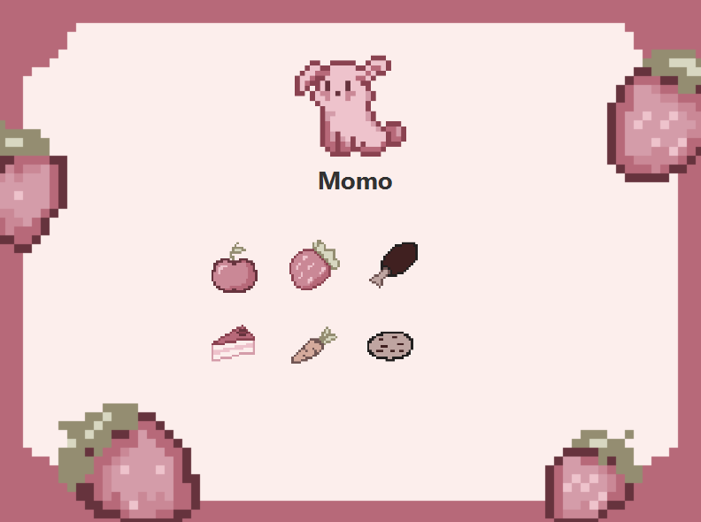

# PocketPet 🐾

A small Java-based virtual pet simulation. Created to show you my basic Java skills.

## Features

- Feed your pet
- Play games
- Manage energy and happiness
- Save progress (TODO)

## Technologies

- Java 21
- Object-oriented programming
- File persistence

## Screenshots

First version (console version)

Graphical Version with JavaFX

## Future Improvements

- GUI with JavaFX
- Multiple pets
- Multiple colors of cats
- Inventory system
- More Mini Games
- Custom Clothes for pets
- Different Food
- Shop system

## Running

run with 'mvn javafx:run'